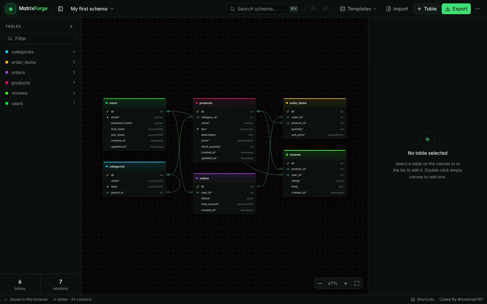

# MatrixForge

A visual database schema designer by [Mohd Amir Khan](https://khanamir.me). Draw tables and relationships on a canvas, then export SQL or an ER diagram. Everything runs in the browser and is saved in local storage; there is no backend.

Live: **https://tool.khanamir.me/matrix**



## Features

- Tables with typed columns: primary, unique, not null, index, auto increment, default, comment, sizes (`VARCHAR(100)`, `DECIMAL(10,2)`) and ENUM values
- Foreign keys with `ON DELETE` actions, drawn as crow's-foot lines that follow the tables; "Link to…" adds a key column in one click
- Renaming a table or column updates every foreign key that points at it
- SQL export for MySQL/MariaDB, PostgreSQL and SQLite: quoted reserved words, composite primary keys, tables ordered by dependency (cycles use `ALTER TABLE`)
- Import `CREATE TABLE` scripts, including `pg_dump` and `mysqldump` output, or a MatrixForge JSON backup
- PNG and SVG export of the whole diagram, plus JSON export
- E-commerce, Blog, CRM and SaaS templates, and automatic layout
- Several projects per browser, undo/redo, search across tables and columns (Ctrl+K), and keyboard shortcuts (press `?`)
- Pan, zoom toward the cursor, pinch-zoom on touch screens; on phones the editor opens as a bottom sheet

## Run locally

```bash
npm install
npm run dev
```

Open [http://localhost:3000](http://localhost:3000). Locally the app runs at `/`; the `/matrix` base path is only applied in CI.

Production build (static export to `out/`):

```bash
NEXT_PUBLIC_APP_URL=https://tool.khanamir.me/matrix npm run build
```

`postbuild` writes `out/.htaccess` (404 page, caching, compression) for Hostinger.

## Code map

- `lib/schema.ts`: IDs, normalization, rename and delete cascades, node geometry, relationship paths, auto layout
- `lib/sql.ts` / `lib/sql-import.ts`: SQL generation and parsing
- `lib/export.ts`: standalone SVG renderer used for PNG/SVG export
- `hooks/use-schema-history.ts`: undo/redo (a whole drag, or a burst of typing, is one step)
- `components/diagram-editor.tsx`: state, projects and shortcuts; `canvas.tsx` handles pan, zoom and dragging

## Deploy

GitHub Actions on `main` / `master` / `production` builds the static site with `NEXT_PUBLIC_APP_URL=https://tool.khanamir.me/matrix` and uploads `out/` over FTPS to `/public_html/tool/matrix/` (served as https://tool.khanamir.me/matrix). The `FTP_SERVER`, `FTP_USERNAME` and `FTP_PASSWORD` repository secrets come from `~/.config/deploy/hostinger-ftp.env`:

```bash
gh secret set -f ~/.config/deploy/hostinger-ftp.env -R madmak787/MatrixForge
```

With that login the FTP top level contains `public_html/`, so every path must start with `/public_html`. You can also run the workflow by hand from the Actions tab (**Build & Deploy MatrixForge**).

`public/module_info.json` and `public/thumbnail.png` describe the tool for the catalog on tool.khanamir.me.
